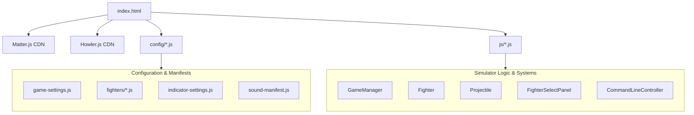

# Duels2D — Current Architecture Guide

This document provides a technical overview of Duels2D’s architecture, runtime flow, and module responsibilities as of June 2026.

> **Terminology migration:** This codebase is transitioning from "character" to "fighter" terminology. See [codebase-refactor-plan.md](codebase-refactor-plan.md) for the phased plan. Sound asset structure is documented in [sound-asset-structure.md](sound-asset-structure.md).

---

## 🏛️ Architectural Overview

Duels2D is a **browser-native, zero-player 2D physics battle simulator** built without complex build pipelines, node modules, bundlers, or transpilers. It runs directly in the browser via standard `<script>` tags, making it lightweight and highly performant for local development.



---

## 🔌 Script Load Order

In [index.html](file:///mnt/c/Users/uhabc/Documents/Web-dev/Duels2D/index.html), scripts must be loaded in a strict sequential order so that globals are initialized before dependent modules read them:

1. **CDNs / External Libraries**:
   - `Matter.js` (Physics Engine)
   - `Howler.js` (Multi-channel Audio Player)
2. **Configurations**:
   - [config/game-settings.js](file:///mnt/c/Users/uhabc/Documents/Web-dev/Duels2D/config/game-settings.js) (Engine & Arena configuration)
   - [config/indicator-settings.js](file:///mnt/c/Users/uhabc/Documents/Web-dev/Duels2D/config/indicator-settings.js) (Health & Damage visual indicators layout)
   - [config/sound-manifest.js](file:///mnt/c/Users/uhabc/Documents/Web-dev/Duels2D/config/sound-manifest.js) (Autogenerated Sound Manifest)
   - `config/fighters/defaults.js`, followed by each `config/fighters/<fighter-id>.js` (one complete definition per fighter)
   - `config/fighter-config.js` (applies defaults and builds the runtime roster)
3. **Core Logic**:
   - [src/entities/fighter.js](file:///mnt/c/Users/uhabc/Documents/Web-dev/Duels2D/src/entities/fighter.js) (Defines `Character` entity, migrating to `Fighter`)
   - [src/entities/projectile.js](file:///mnt/c/Users/uhabc/Documents/Web-dev/Duels2D/src/entities/projectile.js) (Defines `Projectile` entity)
   - [src/ui/fighter-select-panel.js](file:///mnt/c/Users/uhabc/Documents/Web-dev/Duels2D/src/ui/fighter-select-panel.js) (Defines character selection sidebar)
   - [src/engine/game-manager.js](file:///mnt/c/Users/uhabc/Documents/Web-dev/Duels2D/src/engine/game-manager.js) (Coordinates physics engine, loops, triggers, and canvas rendering)
   - [src/boot/start-game.js](file:///mnt/c/Users/uhabc/Documents/Web-dev/Duels2D/src/boot/start-game.js) (Initializes `GameManager` on DOMContentLoaded)
   - [src/ui/command-console.js](file:///mnt/c/Users/uhabc/Documents/Web-dev/Duels2D/src/ui/command-console.js) (Loads the command line controller interface)

---

## 🎛️ Module Responsibilities

### 1. `GameManager` ([src/engine/game-manager.js](file:///mnt/c/Users/uhabc/Documents/Web-dev/Duels2D/src/engine/game-manager.js))
The central brain of the simulator. It controls:
* **Physics Integration**: Instantiates the Matter.js engine, world, and runner. Configures the world with elastic borders and zero-gravity.
* **Canvas Rendering Loop**: A `requestAnimationFrame` loop that clears the canvas, translates/rotates coordinates, and draws fighters, projectiles, damage indicators, sparks, and borders.
* **Aspect Ratio Maintenance**: Resizes the HTML5 Canvas to fit the `9:16` aspect ratio of `#game-container`, supporting standard mobile format crops.
* **State Machine & Loop Updates**: Manages unpaused/paused ticks, triggers proximity-melee attacks, fires projectile weapons, updates visual sparks, and monitors win/death states.

### 2. `Fighter` ([src/entities/fighter.js](file:///mnt/c/Users/uhabc/Documents/Web-dev/Duels2D/src/entities/fighter.js))
Represents a fighter in the arena (legacy name: `Character`). It wraps a Matter.js physics body and controls:
* **Mutable State**: Manages health, hit-flash timers, and weapon animation timers.
* **Visual & Hitbox Decoupling**: Creates physics collision hitboxes (box or circle) independent of visual rendering scale (`imageScale`), position offset (`imageOffset`), and sprite cropping rect (`imageCrop`).
* **Sprite Selection**: Tracks the fighter's internal `weaponState` (`idle` -> `windup` -> `active` -> `recovery` -> `idle`) and returns the appropriate pose sprite.
* **Audio Pools**: Preloads fighter-specific sound pools using `Howler.js` based on the autogenerated sound manifest.

### 3. `Projectile` ([src/entities/projectile.js](file:///mnt/c/Users/uhabc/Documents/Web-dev/Duels2D/src/entities/projectile.js))
Represents a physics-based bullet or object spawned by weapons (e.g. Depressed Guy's tears).
* Wraps a Matter.js circle body with customizable velocity, damage, and owner ID.
* Features a lifetime clock; once expired, the projectile is cleanly pruned from the Matter.js world and `GameManager` array.

### 4. `CommandLineController` ([src/ui/command-console.js](file:///mnt/c/Users/uhabc/Documents/Web-dev/Duels2D/src/ui/command-console.js))
Acts as the developer console and command-line overlay.
* Listens globally to the `/` key to toggle visibility (focusing/defocusing input).
* Prevents simulator hotkeys (like the spacebar unpause) from firing while typing.
* Dispatches text-based commands (`start`, `pause`, `restart`, `select`, `studio`).

---

## 🔄 Data & Execution Flow

```
[ Matter.js Collision Event ]
              │
              ▼
    GameManager: _registerCollisionEvents()
              │
              ├───► Plays bounce sound effect (character or shared)
              │
              └───► (If Projectile/Character Collision)
                         │
                         ▼
                    Character: takeDamage()
                         │
                         ├───► Triggers hit flash (hitFlashTimer = 8)
                         ├───► Spawns floating damage indicator
                         ├───► Plays character 'hurt' sound
                         └───► Checks if dead -> onDeath()
```

### Weapon State Machine
Weapons are evaluated per-tick inside `GameManager._updateWeapons()`. If a character can attack:
1. `startWeaponAnimation()` sets the state to `'windup'` and populates the frame timers.
2. In subsequent frames, `updateWeaponState()` decrements the timers.
3. The state cycles: `windup` ➔ `active` ➔ `recovery` ➔ `idle`.
4. Render updates query `getCurrentSprite()` which selects the corresponding pose image from `poses` based on the active state.
