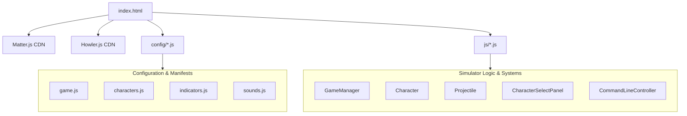

# Duels2D — Current Architecture Guide

This document provides a technical overview of Duels2D’s architecture, runtime flow, and module responsibilities as of June 2026.

---

## 🏛️ Architectural Overview

Duels2D is a **browser-native, zero-player 2D physics battle simulator** built without complex build pipelines, node modules, bundlers, or transpilers. It runs directly in the browser via standard `<script>` tags, making it lightweight and highly performant for local development.



---

## 🔌 Script Load Order

In [index.html](file:///mnt/c/Users/uhabc/Documents/Web-dev/Duels2D/index.html), scripts must be loaded in a strict sequential order so that globals are initialized before dependent modules read them:

1. **CDNs / External Libraries**:
   - `Matter.js` (Physics Engine)
   - `Howler.js` (Multi-channel Audio Player)
2. **Configurations**:
   - [config/game.js](file:///mnt/c/Users/uhabc/Documents/Web-dev/Duels2D/config/game.js) (Engine & Arena configuration)
   - [config/indicators.js](file:///mnt/c/Users/uhabc/Documents/Web-dev/Duels2D/config/indicators.js) (Health & Damage visual indicators layout)
   - [config/sounds.js](file:///mnt/c/Users/uhabc/Documents/Web-dev/Duels2D/config/sounds.js) (Autogenerated Sound Manifest)
   - [config/characters.js](file:///mnt/c/Users/uhabc/Documents/Web-dev/Duels2D/config/characters.js) (Character rosters, stats, and weapons configuration)
3. **Core Logic**:
   - [js/character.js](file:///mnt/c/Users/uhabc/Documents/Web-dev/Duels2D/js/character.js) (Defines `Character` entity)
   - [js/projectile.js](file:///mnt/c/Users/uhabc/Documents/Web-dev/Duels2D/js/projectile.js) (Defines `Projectile` entity)
   - [js/character-select.js](file:///mnt/c/Users/uhabc/Documents/Web-dev/Duels2D/js/character-select.js) (Defines character selection sidebar)
   - [js/game-manager.js](file:///mnt/c/Users/uhabc/Documents/Web-dev/Duels2D/js/game-manager.js) (Coordinates physics engine, loops, triggers, and canvas rendering)
   - [js/game.js](file:///mnt/c/Users/uhabc/Documents/Web-dev/Duels2D/js/game.js) (Initializes `GameManager` on DOMContentLoaded)
   - [js/command-line.js](file:///mnt/c/Users/uhabc/Documents/Web-dev/Duels2D/js/command-line.js) (Loads the command line controller interface)

---

## 🎛️ Module Responsibilities

### 1. `GameManager` ([js/game-manager.js](file:///mnt/c/Users/uhabc/Documents/Web-dev/Duels2D/js/game-manager.js))
The central brain of the simulator. It controls:
* **Physics Integration**: Instantiates the Matter.js engine, world, and runner. Configures the world with elastic borders and zero-gravity.
* **Canvas Rendering Loop**: A `requestAnimationFrame` loop that clears the canvas, translates/rotates coordinates, and draws characters, projectiles, damage indicators, sparks, and borders.
* **Aspect Ratio Maintenance**: Resizes the HTML5 Canvas to fit the `9:16` aspect ratio of `#game-container`, supporting standard mobile format crops.
* **State Machine & Loop Updates**: Manages unpaused/paused ticks, triggers proximity-melee attacks, fires projectile weapons, updates visual sparks, and monitors win/death states.

### 2. `Character` ([js/character.js](file:///mnt/c/Users/uhabc/Documents/Web-dev/Duels2D/js/character.js))
Represents a fighter in the arena. It wraps a Matter.js physics body and controls:
* **Mutable State**: Manages health, hit-flash timers, and weapon animation timers.
* **Visual & Hitbox Decoupling**: Creates physics collision hitboxes (box or circle) independent of visual rendering scale (`imageScale`), position offset (`imageOffset`), and sprite cropping rect (`imageCrop`).
* **Sprite Selection**: Tracks the character’s internal `weaponState` (`idle` -> `windup` -> `active` -> `recovery` -> `idle`) and returns the appropriate pose sprite.
* **Audio Pools**: Preloads character-specific sound pools using `Howler.js` based on the autogenerated sound manifest.

### 3. `Projectile` ([js/projectile.js](file:///mnt/c/Users/uhabc/Documents/Web-dev/Duels2D/js/projectile.js))
Represents a physics-based bullet or object spawned by weapons (e.g. Depressed Guy's tears).
* Wraps a Matter.js circle body with customizable velocity, damage, and owner ID.
* Features a lifetime clock; once expired, the projectile is cleanly pruned from the Matter.js world and `GameManager` array.

### 4. `CommandLineController` ([js/command-line.js](file:///mnt/c/Users/uhabc/Documents/Web-dev/Duels2D/js/command-line.js))
Acts as the developer console and command-line overlay.
* Listens globally to the `/` key to toggle visibility (focusing/defocusing input).
* Prevents simulator hotkeys (like the spacebar unpause) from firing while typing.
* Dispatches text-based commands (`start`, `pause`, `restart`, `select`, `studio`).

---

## 🔄 Data & Execution Flow

```
[ Matter.js Collision Event ]
              │
              ▼
    GameManager: _registerCollisionEvents()
              │
              ├───► Plays bounce sound effect (character or shared)
              │
              └───► (If Projectile/Character Collision)
                         │
                         ▼
                    Character: takeDamage()
                         │
                         ├───► Triggers hit flash (hitFlashTimer = 8)
                         ├───► Spawns floating damage indicator
                         ├───► Plays character 'hurt' sound
                         └───► Checks if dead -> onDeath()
```

### Weapon State Machine
Weapons are evaluated per-tick inside `GameManager._updateWeapons()`. If a character can attack:
1. `startWeaponAnimation()` sets the state to `'windup'` and populates the frame timers.
2. In subsequent frames, `updateWeaponState()` decrements the timers.
3. The state cycles: `windup` ➔ `active` ➔ `recovery` ➔ `idle`.
4. Render updates query `getCurrentSprite()` which selects the corresponding pose image from `poses` based on the active state.
